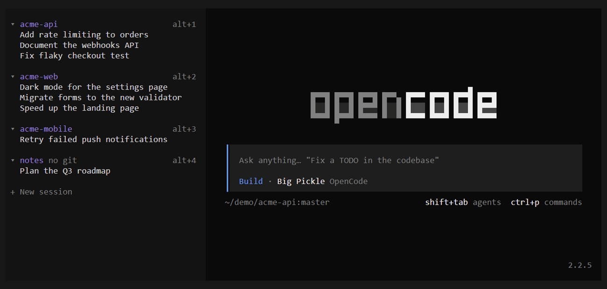

# opencode-better-tabs

A plugin for the [OpenCode](https://opencode.ai) TUI (v2) that redraws the vertical session tab bar on the left:
tabs are grouped by git repository, every group and tab has a visible keyboard shortcut, and each group header
shows how many sessions are working, waiting for you, or unread.

> Supports OpenCode V2 2.2.5 or newer. V1 is not supported.

<p align="center">
  
</p>

The demo shows tabs grouped by repository, opening a tab with two shortcuts (`alt+2`, `alt+2`), moving a group up
with `alt+↑`, and searching all tabs with `/tabs`. It uses made-up repositories and sessions; see
`docs/demo.tape` to record it again.

## Features

- **Grouped by repository.** Worktrees belong to their repository's group. Sessions outside any git repository
  get one group per directory, marked `no git`.
- **Two-step shortcuts.** `alt+1` selects the first group; the group labels disappear and the tabs of that group
  show their own keys. Press one (`alt+3`) to open that tab. The selection resets after 3 s, or press `esc`
  (`alt+x`, `alt+esc`) to cancel.
- **Activity counters** on each group header:
  | Mark | Meaning |
  |---|---|
  | `⠋2` (blue, animated) | sessions working |
  | `!1` (yellow) | sessions waiting for you (question, permission) |
  | `•3` (accent, red on error) | sessions with unread output |

  When the header runs out of room, `•` disappears first and `!` last.
- **Collapsible groups.** Click a header to collapse it; a collapsed group still shows its active tab. Selecting a
  collapsed group with `alt+N` opens it until you pick a tab.
- **Reorder groups** by dragging a header with the mouse, or select a group with `alt+N` and press
  `alt+↑` / `alt+↓`. The order is saved and the built-in tab order follows it.
- **Close tabs** with the `✕` that appears on hover, or with a middle click.
- **Hide the bar** with a command, and show it again.

## Requirements

- OpenCode V2 2.2.5 or newer, with vertical tabs.
- Windows, macOS or Linux. No other tools are needed: the plugin ships compiled JavaScript.

## Install

Install a release from GitHub with the OpenCode CLI. Pin the tag: a pinned install is cached and OpenCode can tell
when a newer release exists.

```sh
opencode plugin add github:igorovh/opencode-better-tabs#v0.4.0
```

This adds the plugin to the global `plugins` array in `~/.config/opencode/opencode.jsonc`. Restart the TUI and the
new tab bar replaces the built-in one.

You can also add the entry to the config yourself:

```jsonc
{
  "$schema": "https://opencode.ai/config.json",
  "plugins": ["github:igorovh/opencode-better-tabs#v0.4.0"]
}
```

To move to a newer release, change the tag. To remove the plugin:

```sh
opencode plugin remove github:igorovh/opencode-better-tabs#v0.4.0
```

## Keys and commands

| Shortcut | Slash command | Action |
|---|---|---|
| `alt+<key>` then `alt+<key>` | | Select a group, then a tab in it |
| `alt+↑` / `alt+↓` (group selected) | | Move the selected group |
| `esc`, `alt+x`, `alt+esc` (group selected) | | Cancel the selection |
| `<leader>p` | `/tabs` | Search all tabs |
| | `/close`, `/archive` | Close the current tab (the session is kept) |
| `<leader>h` | `/tabs-hide` | Show or hide the tab bar |
| | | Palette: group tabs now, toggle automatic grouping, collapse or expand all |

The key order is `1`–`9`, then `c g h i j k l m n o p q r s t u v w x y z`. `a b d e f` are skipped because
OpenCode uses `alt+a/b/d/e/f` to edit the prompt. Groups and the tabs inside a group use the same order.

## Options

The tab bar runs in the TUI, and OpenCode passes plugin options to the TUI only from `~/.config/opencode/cli.json`
(or `$OPENCODE_CONFIG_DIR/cli.json`). Options in `opencode.jsonc` reach only the server part, which does nothing.
Add an entry to `cli.json` whose `package` is exactly the same string as in `opencode.jsonc`, tag included:

```jsonc
{
  "plugins": [
    {
      "package": "github:igorovh/opencode-better-tabs#v0.4.0",
      "options": { "modifier": "alt", "keys": "123456789cghijklmnopqrstuvwxyz" }
    }
  ]
}
```

`opencode plugin add` does not write options, so add this entry yourself.

- `modifier`: modifier for the shortcuts, such as `alt`, `ctrl` or `ctrl+shift`. The default is `alt` because many
  terminals send `ctrl+1` as a plain `1`. An invalid value shows a warning and falls back to `alt`.
- `keys`: the key pool, in order. Only `a`–`z` and `0`–`9` are used.
- `confirmClose`: ask before closing a tab with the `✕` or a middle click. Default `false`, so the tab closes at
  once. The `/close` and `/archive` commands never ask: they are explicit.
- `padding`: blank lines above and below the label of every row (tab, group header and `+ New session`), from `0`
  to `3`. Default `0`, so rows stay one line tall. Set it to `1` to give the hover and active backgrounds some
  air: the row grows to `1 + padding × 2` lines. Terminal rows are one cell tall, so a gap is a whole blank line.

To change or turn off a command shortcut, set its command ID under `keybinds` in the same `cli.json`. Use `"none"`
to turn it off:

```jsonc
{
  "keybinds": { "better-tabs.picker": "ctrl+t", "better-tabs.hide": "none" }
}
```

The IDs are `better-tabs.picker` and `better-tabs.hide`.

## How it works

The plugin renders an overlay on top of OpenCode's own vertical tab bar and reads its data from the
`ui.tabs` plugin API. It does not patch OpenCode, so the built-in bar is still underneath, and resizing it
resizes the overlay.

The plugin ships JSX that is already compiled, in `dist/`. OpenCode compiles Solid JSX only for plugins outside
`node_modules`, and a GitHub install lives in its package cache
([anomalyco/opencode#39986](https://github.com/anomalyco/opencode/issues/39986)). `dist/` imports only the modules
OpenCode shares with plugins (`@opencode/plugin`, `@opentui/core`, `@opentui/solid`, `solid-js`), so the plugin uses
the host's own copies.

- **Hiding** writes `tabs.mode` to `cli.json`. Only that value changes; comments and other settings stay. If
  `OPENCODE_CLI_CONFIG_CONTENT` sets `tabs`, that wins and the toggle has no effect.
- The plugin makes no network requests and runs no commands.

## Development

Requires [Bun](https://bun.sh).

```sh
git clone https://github.com/igorovh/opencode-better-tabs.git
cd opencode-better-tabs
bun install
bun run typecheck
bun test
```

The sources are in `src/`, but OpenCode loads `dist/`. Run `bun run compile` after a change and commit `dist/`
together with the sources; CI fails when they differ.

To preview a UI change, render the tab bar with sample tabs to a PNG:

```sh
bun run preview -- --out bar.png
```

Pass plugin options with `--options '{"padding":1}'` and hover a row with `--hover "<row text>"`. When a
change affects what the bar shows, render it on the base branch and on your branch and post both images as
"Before" and "After".

To run your checkout instead of the published plugin, put its path in `plugins` and keep the compiler running.
OpenCode reloads the plugin whenever `dist/` changes.

```jsonc
{
  "plugins": ["/path/to/opencode-better-tabs"]
}
```

```sh
bun run compile --watch
```

## License

[MIT](LICENSE)
