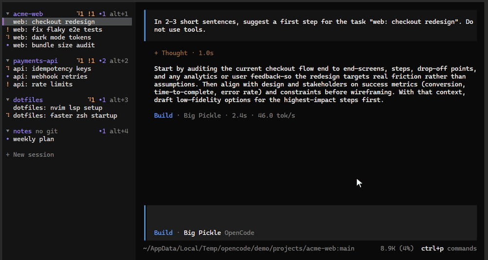

# opencode-better-tabs

A plugin for the [OpenCode](https://opencode.ai) TUI (v2) that redraws the vertical session tab bar on the left:
tabs are grouped by git repository, every group and tab has a visible keyboard shortcut, and each group header
shows how many sessions are working, waiting for you, or unread.

> Supports OpenCode V2 only (built against `@opencode/plugin` 2.0.26). V1 is not supported.

<p align="center">
  
</p>

The demo shows, in order: two-step shortcuts (`alt+2` then `alt+3`), collapsing a group with a click and opening it
with its shortcut, moving a group with `alt+↑`, dragging a group with the mouse, closing a tab with `✕`, compact
mode, and tab search.

## Features

- **Grouped by repository.** Worktrees belong to their repository's group. Sessions outside any git repository
  get one group per directory, marked `no git`.
- **Two-step shortcuts.** `alt+1` selects the first group; the group labels disappear and the tabs of that group
  show their own keys. Press one (`alt+3`) to open that tab. The selection resets after 3 s, or press `esc`
  (`alt+x`, `alt+esc`) to cancel.
- **Activity counters** on each group header:
  | Mark | Meaning |
  |---|---|
  | `⠋2` (blue, animated) | sessions working |
  | `!1` (yellow) | sessions waiting for you (question, permission) |
  | `•3` (accent, red on error) | sessions with unread output |

  When the header runs out of room, `•` disappears first and `!` last.
- **Collapsible groups.** Click a header to collapse it; a collapsed group still shows its active tab. Selecting a
  collapsed group with `alt+N` opens it until you pick a tab.
- **Reorder groups** by dragging a header with the mouse, or select a group with `alt+N` and press
  `alt+↑` / `alt+↓`. The order is saved and the built-in tab order follows it.
- **Close tabs** with the `✕` that appears on hover, or with a middle click.
- **Compact mode and hiding** the bar, through commands.

## Requirements

- OpenCode V2 2.0.26 or newer, with vertical tabs.

## Install

Install the plugin from GitHub with the OpenCode CLI:

```sh
opencode plugin add github:igorovh/opencode-better-tabs
```

To pin a release, add its tag:

```sh
opencode plugin add github:igorovh/opencode-better-tabs#v0.1.5
```

This adds the plugin to the global `plugins` array in `~/.config/opencode/opencode.jsonc`. Restart the TUI and the
new tab bar replaces the built-in one.

You can also add the entry to the config yourself:

```jsonc
{
  "$schema": "https://opencode.ai/config.json",
  "plugins": ["github:igorovh/opencode-better-tabs"]
}
```

Update or remove it later:

```sh
opencode plugin update github:igorovh/opencode-better-tabs
opencode plugin remove github:igorovh/opencode-better-tabs
```

## Keys and commands

| Shortcut | Slash command | Action |
|---|---|---|
| `alt+<key>` then `alt+<key>` | | Select a group, then a tab in it |
| `alt+↑` / `alt+↓` (group selected) | | Move the selected group |
| `esc`, `alt+x`, `alt+esc` (group selected) | | Cancel the selection |
| `<leader>p` | `/tabs` | Search all tabs |
| | `/close`, `/archive` | Close the current tab (the session is kept) |
| `<leader>k` | `/tabs-compact` | Toggle compact mode |
| `<leader>h` | `/tabs-hide` | Show or hide the tab bar |
| | | Palette: group tabs now, toggle automatic grouping, collapse or expand all |

The key order is `1`–`9`, then `c g h i j k l m n o p q r s t u v w x y z`. `a b d e f` are skipped because
OpenCode uses `alt+a/b/d/e/f` to edit the prompt. Groups and the tabs inside a group use the same order.

## Options

```jsonc
{
  "plugins": [
    {
      "package": "github:igorovh/opencode-better-tabs",
      "options": { "modifier": "alt", "keys": "123456789cghijklmnopqrstuvwxyz" }
    }
  ]
}
```

- `modifier`: modifier for the shortcuts. The default is `alt` because many terminals send `ctrl+1` as a plain `1`.
- `keys`: the key pool, in order. Only `a`–`z` and `0`–`9` are used.

## How it works

The plugin renders an overlay on top of OpenCode's own vertical tab bar and reads its data from the
`ui.tabs` plugin API. It does not patch OpenCode, so the built-in bar is still underneath, and resizing it
resizes the overlay.

- **Compact mode** writes `verticalTabsWidth` to OpenCode's `layout.json` in its state directory.
- **Hiding** writes `tabs.mode` to `~/.config/opencode/cli.json`. If `OPENCODE_CLI_CONFIG_CONTENT` sets `tabs`,
  that wins and the toggle has no effect.

## Development

Requires [Bun](https://bun.sh).

```sh
git clone https://github.com/igorovh/opencode-better-tabs.git
cd opencode-better-tabs
bun install
bun run typecheck
```

To run your checkout instead of the published plugin, put its path in `plugins` and restart the TUI. After that,
OpenCode reloads the plugin whenever a file changes.

```jsonc
{
  "plugins": ["/path/to/opencode-better-tabs"]
}
```

## License

[MIT](LICENSE)
