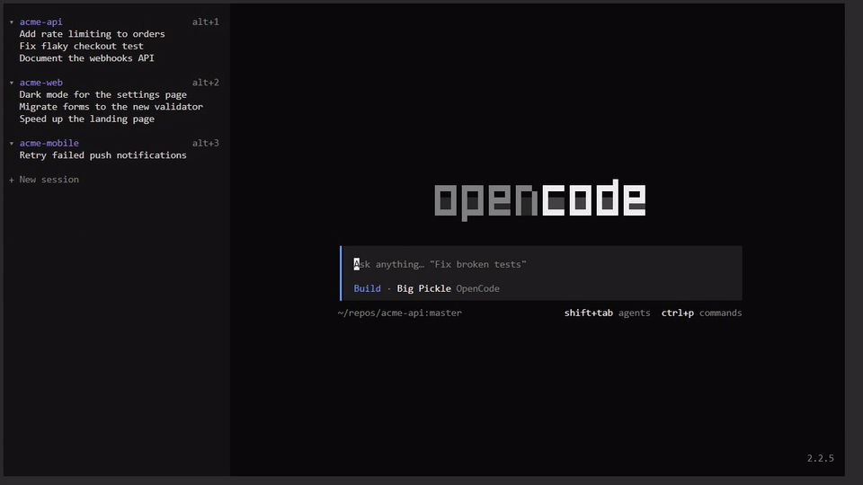
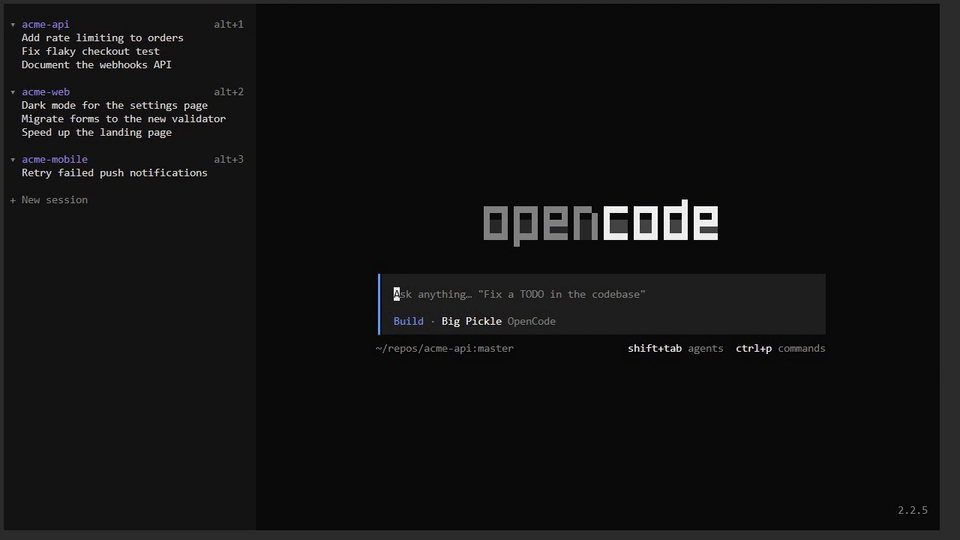

# opencode-better-tabs

A plugin for the [OpenCode](https://opencode.ai) TUI (v2) that redraws the vertical session tab bar on the left:
tabs are grouped by git repository or into groups you make yourself, every group and tab has a visible keyboard
shortcut, groups and tabs can be dragged into any order, and each group header shows how many sessions are working,
waiting for you, or unread.

> Supports OpenCode V2 2.2.5 or newer. V1 is not supported.

<p align="center">
  
</p>

The demo shows tabs grouped by repository, opening a tab with two shortcuts (`alt+2`, `alt+2`), dragging a group
to the top and a tab within its group, collapsing a group, closing a tab with its `✕`, and searching all tabs with
`/tabs`. It uses made-up repositories and sessions; see [Development](#development) to record it again.

## Features

- **Grouped by repository.** Worktrees belong to their repository's group. Sessions outside any git repository
  get one group per directory, marked `no git`. OpenCode gives a repository a new project ID when its first commit
  is rewritten (`git rebase --root`, `git filter-repo`); sessions from before and after still share one group.
- **Two-step shortcuts.** `alt+1` selects the first group; the group labels disappear and the tabs of that group
  show their own keys. Press one (`alt+3`) to open that tab. The selection resets after 3 s, or press `esc`
  (`alt+x`, `alt+esc`) to cancel.
- **Activity counters** on each group header:
  | Mark | Meaning |
  |---|---|
  | `⠋2` (blue, animated) | sessions working |
  | `!1` (yellow) | sessions waiting for you (question, permission) |
  | `•3` (accent, red on error) | sessions with unread output |

  When the header runs out of room, `•` disappears first and `!` last.
- **Collapsible groups.** Click a header to collapse it; a collapsed group still shows its active tab. Selecting a
  collapsed group with `alt+N` opens it until you pick a tab.
- **Reorder groups** by dragging a header with the mouse, or select a group with `alt+N` and press
  `alt+↑` / `alt+↓`. The order is saved and the built-in tab order follows it.
- **Reorder tabs** inside an expanded group by dragging them with the mouse.
- **Custom groups**, as a second way to group tabs. See [Custom groups](#custom-groups).
- **Sub-sessions** sit indented and dimmed under their parent tab, even when they come from another repository.
  See [Sub-sessions](#sub-sessions).
- **Sort by recent activity** with the `sort` option: the group and the tab where you last sent a message move to
  the top.
- **Close tabs** with the `✕` that appears on hover, or with a middle click.
- **Hide the bar** with a command, and show it again.

## Custom groups

Tabs are grouped by repository by default. Switch to custom groups to sort them your own way, for example by task.
Your custom groups are saved, so you can switch back and forth.

<p align="center">
  
</p>

- **Switch** with `/groups`, which lists your groups and the two ways to group. "Custom groups, starting from
  repositories" puts every tab in a group named after its repository, so you can start from there.
- **Make a group** by dropping a tab onto a tab in `Ungrouped`. The two tabs form `Group 1`.
- **Add a tab** to a group by dropping it on the group's header or tabs, with `/group <name>`, or with a right-click
  on the tab. `/group <name>` also makes the group when it does not exist yet, and turns custom groups on.
- **Rename or remove a group** with a right-click on its header, or pick it in `/groups`. Removing a group moves its
  tabs to `Ungrouped`.
- Tabs that are in no group sit in `Ungrouped`, which always stays last. `/ungroup` moves the current tab there.

## Sub-sessions

A tab can hold sub-sessions: other tabs shown right under it, indented with `└` and in a dimmer colour. The parent
shows how many it has, such as `+2`.

- **Where they come from.** A session that OpenCode started for another one (its `parentID`) is a sub-session
  automatically. An agent can attach a session to its own with the `better_tabs_attach` tool, for example one it
  just started. You can attach a tab yourself with a right-click (`Attach to a tab…`) or `/attach`.
- **Groups.** Only parent tabs belong to a group. A sub-session always follows its parent, in repository and in
  custom groups. Its own custom group is kept and comes back when you detach it.
- **Detach** with a right-click on the sub-session or `/detach`. Closing the parent tab also turns its sub-sessions
  into normal tabs in their own groups.
- Dragging a parent moves its sub-sessions with it. Sub-sessions themselves are not dragged. Only one level is
  shown: a sub-session of a sub-session sits under the top parent.

## Requirements

- OpenCode V2 2.2.5 or newer, with vertical tabs.
- Windows, macOS or Linux. No other tools are needed: the plugin ships compiled JavaScript.

## Install

Install a release from GitHub with the OpenCode CLI. Pin the tag: a pinned install is cached and OpenCode can tell
when a newer release exists.

```sh
opencode plugin add github:igorovh/opencode-better-tabs#v0.6.0
```

This adds the plugin to the global `plugins` array in `~/.config/opencode/opencode.jsonc`. Restart the TUI and the
new tab bar replaces the built-in one.

You can also add the entry to the config yourself:

```jsonc
{
  "$schema": "https://opencode.ai/config.json",
  "plugins": ["github:igorovh/opencode-better-tabs#v0.6.0"]
}
```

To move to a newer release, change the tag. To remove the plugin:

```sh
opencode plugin remove github:igorovh/opencode-better-tabs#v0.6.0
```

## Keys and commands

| Shortcut | Slash command | Action |
|---|---|---|
| `alt+<key>` then `alt+<key>` | | Select a group, then a tab in it |
| `alt+↑` / `alt+↓` (group selected) | | Move the selected group |
| `esc`, `alt+x`, `alt+esc` (group selected) | | Cancel the selection |
| `<leader>p` | `/tabs` | Search all tabs |
| | `/groups` | List custom groups, rename or remove one, and switch between repository and custom groups |
| | `/group <name>` | Move the current tab to a custom group; without a name, pick one from a list |
| | `/ungroup` | Move the current tab back to `Ungrouped` |
| | `/attach` | Show the current tab as a sub-session under another tab |
| | `/detach` | Show the current sub-session as a normal tab again |
| right-click a tab | | Move the tab to a custom group, or attach or detach it |
| right-click a group header | | Rename or remove a custom group |
| | `/close`, `/archive` | Close the current tab (the session is kept) |
| `<leader>h` | `/tabs-hide` | Show or hide the tab bar |
| | | Palette: group tabs now, switch between repository and custom groups, toggle automatic grouping, collapse or expand all |

The key order is `1`–`9`, then `c g h i j k l m n o p q r s t u v w x y z`. `a b d e f` are skipped because
OpenCode uses `alt+a/b/d/e/f` to edit the prompt. Groups and the tabs inside a group use the same order.

## Options

The tab bar runs in the TUI, and OpenCode passes plugin options to the TUI only from `~/.config/opencode/cli.json`
(or `$OPENCODE_CONFIG_DIR/cli.json`). Options in `opencode.jsonc` reach only the server part, which only adds the `better_tabs_attach` tool and reads no options.
Add an entry to `cli.json` whose `package` is exactly the same string as in `opencode.jsonc`, tag included:

```jsonc
{
  "plugins": [
    {
      "package": "github:igorovh/opencode-better-tabs#v0.6.0",
      "options": { "modifier": "alt", "keys": "123456789cghijklmnopqrstuvwxyz" }
    }
  ]
}
```

`opencode plugin add` does not write options, so add this entry yourself.

- `modifier`: modifier for the shortcuts, such as `alt`, `ctrl` or `ctrl+shift`. The default is `alt` because many
  terminals send `ctrl+1` as a plain `1`. An invalid value shows a warning and falls back to `alt`.
- `keys`: the key pool, in order. Only `a`–`z` and `0`–`9` are used.
- `confirmClose`: ask before closing a tab with the `✕` or a middle click. Default `false`, so the tab closes at
  once. The `/close` and `/archive` commands never ask: they are explicit.
- `padding`: blank lines above and below the label of every row (tab, group header and `+ New session`), from `0`
  to `3`. Default `0`, so rows stay one line tall. Set it to `1` to give the hover and active backgrounds some
  air: the row grows to `1 + padding × 2` lines. Terminal rows are one cell tall, so a gap is a whole blank line.
- `sort`: `"manual"` (default) keeps the order you set by dragging. `"recent"` puts the group and the tab whose
  session last started working first, so a tab moves once when you send a message, not while it works. Tabs that
  never ran count from when they were created. Dragging and `alt+↑` / `alt+↓` are off in this mode.

To change or turn off a command shortcut, set its command ID under `keybinds` in the same `cli.json`. Use `"none"`
to turn it off:

```jsonc
{
  "keybinds": { "better-tabs.picker": "ctrl+t", "better-tabs.hide": "none" }
}
```

The IDs are `better-tabs.picker` and `better-tabs.hide`.

## How it works

The plugin renders an overlay on top of OpenCode's own vertical tab bar and reads its data from the
`ui.tabs` plugin API. It does not patch OpenCode, so the built-in bar is still underneath, and resizing it
resizes the overlay.

The plugin ships JSX that is already compiled, in `dist/`. OpenCode compiles Solid JSX only for plugins outside
`node_modules`, and a GitHub install lives in its package cache
([anomalyco/opencode#39986](https://github.com/anomalyco/opencode/issues/39986)). `dist/` imports only the modules
OpenCode shares with plugins (`@opencode/plugin`, `@opentui/core`, `@opentui/solid`, `solid-js`), so the plugin uses
the host's own copies.

- **Hiding** writes `tabs.mode` to `cli.json`. Only that value changes; comments and other settings stay. If
  `OPENCODE_CLI_CONFIG_CONTENT` sets `tabs`, that wins and the toggle has no effect.
- **Sub-session links** you set in the bar are saved in the plugin's TUI storage. The `better_tabs_attach` tool
  writes the link to the session's metadata (`betterTabs.parent`) instead, so it also reaches the TUI. A link set in
  the bar wins over the tool's, and both win over OpenCode's `parentID`.
- The plugin makes no network requests and runs no commands.

## Development

Requires [Bun](https://bun.sh).

```sh
git clone https://github.com/igorovh/opencode-better-tabs.git
cd opencode-better-tabs
bun install
bun run typecheck
bun test
```

The sources are in `src/`, but OpenCode loads `dist/`. Run `bun run compile` after a change and commit `dist/`
together with the sources; CI fails when they differ.

To preview a UI change, render the tab bar with sample tabs to a PNG:

```sh
bun run preview -- --out bar.png
```

Pass plugin options with `--options '{"padding":1}'` and hover a row with `--hover "<row text>"`. When a
change affects what the bar shows, render it on the base branch and on your branch and post both images as
"Before" and "After".

To record the real OpenCode TUI to a GIF, run `bun run record`. It needs `opencode` (V2), `ttyd` and `ffmpeg` on
`PATH` (or `OPENCODE_BIN` and `TTYD_BIN`) and Playwright's Chromium. The README demos are recorded with:

```sh
bun run record -- --out docs/demo.gif --sessions docs/demo.json --steps docs/demo.steps
bun run record -- --out docs/groups.gif --sessions docs/demo.json --steps docs/groups.steps
```

Run `bun run record` without steps to see the step list. The `expect` steps in the `.steps` files fail the
recording when the bar does not behave as shown, so the demos double as tests.

To run your checkout instead of the published plugin, put its path in `plugins` and keep the compiler running.
OpenCode reloads the plugin whenever `dist/` changes.

```jsonc
{
  "plugins": ["/path/to/opencode-better-tabs"]
}
```

```sh
bun run compile --watch
```

## License

[MIT](LICENSE)
